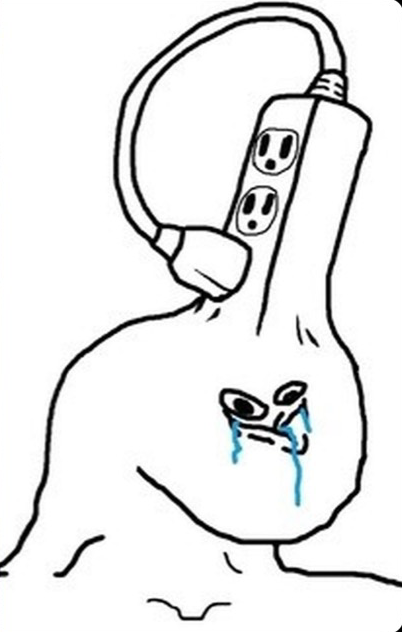
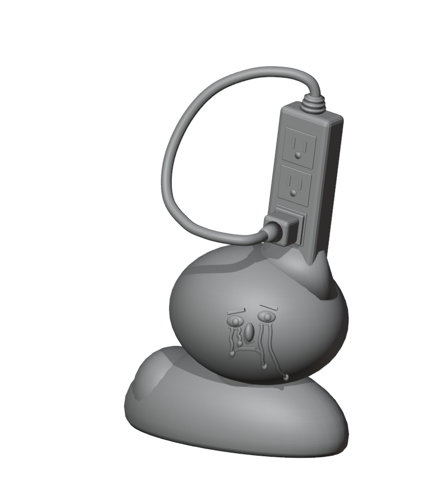
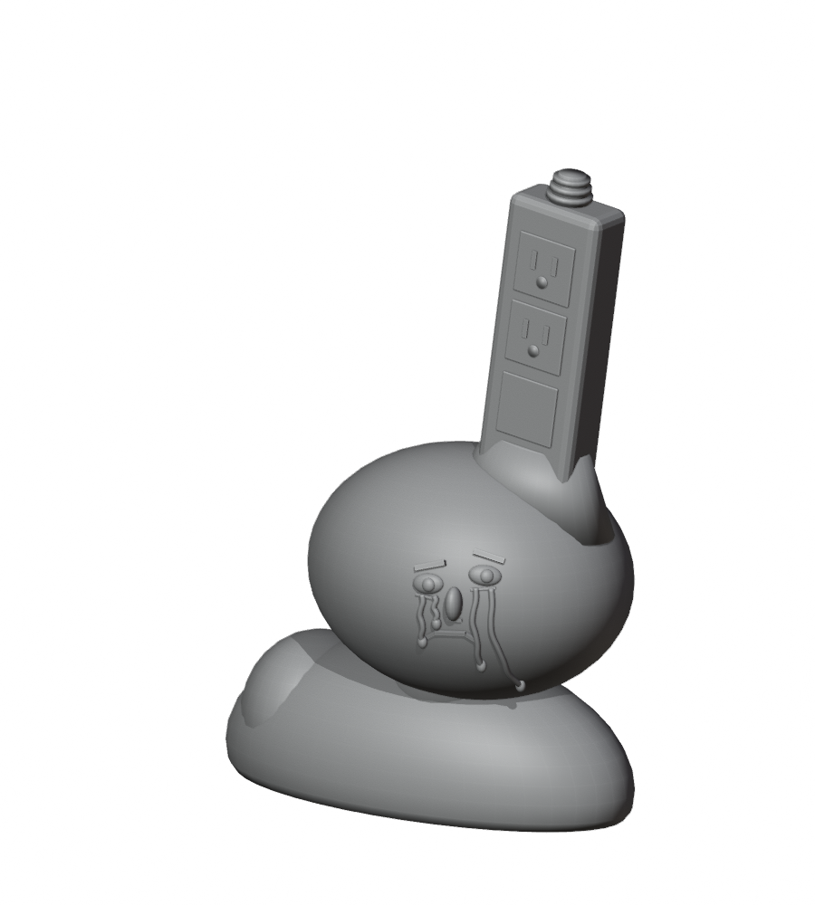

# wojak-claude

An empirical notebook on what Claude preserves, omits and invents when reconstructing a drawing in 3D.

The starting example is a Wojak whose head incorporates a power strip with its own cable plugged back into it. A published 3D replica appeared to merge the cable end into the head beside the strip. This study uses fresh Claude sessions, retained Blender geometry and independent mesh checks to investigate that discrepancy.

**Initial snapshot: 14 November 2026.** The repository contains **22 experimental attempts, 20 completed answers, two retained process timeouts and ten executed Blender scenes**. It is a small, single-image investigation. The original author's prompt, generated mesh and agent trace are unavailable, so these experiments do not reproduce or explain that original run conclusively.

## What we found

| Probe | Completed examples | Observation |
| --- | ---: | --- |
| Reference descriptions | 3 | All recognise the self-plugging joke and qualify their account of the precise connection. |
| Published-sculpture descriptions | 3 | All describe the cable end entering the head beside the strip. |
| Drawing/sculpture comparisons | 3 | All treat the attachment as similar; all notice the change from eye-origin tears to mouth-origin drips. |
| Initial open reconstruction | 2 | Both put the plug in the neck/shoulder beside the strip. |
| Explicit attachment instruction | 2 | Both depict the plug seated on a front socket, but the prongs intersect solid plastic. |
| Fresh baseline for the fidelity control | 2 | One head/neck contact and one strip contact without a supported receiving socket. |
| General fidelity/checking instruction | 2 | The same category counts as the fresh baseline; neither depicts a seated receiving socket. |
| Fully specified text-only receptacles | 2 | Both construct actual cavities and pass independent clearance, volume, bounds and object-count checks. |

The table covers 19 completed main observations. One additional completed image-ingestion pilot is retained separately. The two timed-out calls have no quality score; their fresh replacements are included in the completed reconstruction examples.

### A connection can look right while its geometry is wrong

| Source drawing | A replica that passed the depicted-attachment criterion | The same replica with the plug hidden for inspection |
| --- | --- | --- |
|  |  |  |

In both attachment-success replicas, the housing remains solid where the prongs enter it. Exact Boolean intersection measures **73.1% of each prong's volume inside plastic in one scene and 68.8% in the other**. The outlet marks are positive surface geometry rather than receiving voids. The checker is calibrated against a solid block, a shallow recess and a genuinely hollow receptacle with known expected results.

The [text-only control's actual cavities](results/20261114T181143378123Z-receptacle-construction/construct_receptacle-1/geometry/open-receptacles.png) demonstrate available construction capability under explicit requirements. They do not demonstrate that the model will preserve that property spontaneously from an image. Inspection views change named objects' render visibility only; the original scene files remain unchanged and their hashes are checked.

The earlier sculpture prompt permitted overlapping solids and excluded mechanical mating. The volumetric audit adds a separate criterion while retaining the earlier attachment scores.

## What the findings mean

The study separates four questions:

1. **Recognition:** does the response identify the subject and its familiar meaning?
2. **Fidelity:** does the reconstruction preserve the features and relationships that distinguish this particular drawing?
3. **Geometry:** do apparent holes and connections exist as the required volumes and surfaces?
4. **Verification:** can a check detect an omission independently of the generator's description?

A model's reported uncertainty does **not** establish that the source lacks sufficient clues. Likewise, agreement between the same model's description, generator and comparison can reflect a shared omission. Neither observation independently validates fidelity.

The general-check result concerns one wording and two samples per condition. The text-only control supplies exact geometry and therefore tests a different task. These findings do not estimate a model-wide failure rate, identify a proprietary internal mechanism, or establish that more elaborate prompts cannot help.

Read the [commentary](docs/commentary.md) for the distinction between broad resemblance, identifying features and physical affordances. The [detailed report](docs/study-report.md) retains the observations and their interpretation; [study design](docs/study-design.md) records hypotheses and experimental decisions.

## Method and retained evidence

- **Model:** exact `claude-fable-5-2`, high effort, first-party provider through Claude Code 2.1.321.
- **Isolation:** fresh, non-persistent sessions; fixed system prompts; safe mode; no tools or MCP servers. Reconstruction sessions receive no rendered feedback.
- **Inputs:** a literal crop excluding the post's caption and model attribution, or the publisher's retained sculpture renders. Text-only controls receive no images. Source bytes and hashes are retained.
- **Geometry:** generated Python executed in Blender 5.2.1 LTS after source review. Every completed construction ran without geometry repairs and has fixed front/oblique renders and a saved scene.
- **Scoring:** source and render inspection by an assessor who knew the conditions; independent evaluated-mesh intersection and dimensional checks for the receptacle control.
- **Provenance:** protocols committed before their corresponding calls; image hashes, effective prompts, model settings, code revisions, raw streams, answers and failures retained per attempt.
- **Sampling limits:** the dispatch seed shuffles call order; it does not control model sampling. Temperature and generation seed are not set by these CLI invocations.

The original 300-second construction deadline excluded two calls still reporting progress. A committed recovery rule allowed one fresh replacement per timeout with a 600-second deadline. Both original attempts remain in the record. Later cohorts used 600 seconds from the outset.

[Accounting](results/accounting.json) reports $10.882532 in CLI list-price equivalents for completed experimental calls. Costs of two aborted calls are unknown. These figures are usage accounting, not claims of additional subscription charges; text-only availability checks are outside the dataset.

## Read the evidence

| Location | Contents |
| --- | --- |
| [inputs/](inputs/) | Original screenshot, caption-free crop, publisher renders and provenance hashes |
| [evidence/](evidence/README.md) | Dated contextual webpage snapshots, attribution and retrieval metadata; never supplied to model sessions |
| [protocol/](protocol/) | Exact prompts, settings, scoring criteria, recovery policies and audit cases |
| [results/](results/) | Raw attempts, extracted answers, source, renders, scenes, audit outputs and assessments |
| [Perception assessment](results/perception-assessment.json) | Complete-answer review of the nine perception observations |
| [Initial reconstruction assessment](results/reconstruction-assessment.json) | Four completed image reconstructions and retained timeout exclusions |
| [General fidelity assessment](results/fidelity-check-assessment.json) | Fresh baseline versus a general checking instruction |
| [Receptacle assessment](results/receptacle-assessment.json) | Physical collision measurements and text-only capability controls |
| [scripts/](scripts/) | Collection, input preparation, rendering, geometry auditing and evidence verification |
| [STUDY-STATE.json](STUDY-STATE.json) | Completed cohorts and the next continuation point |

Historical protocols and raw answers retain their original wording, including assumptions corrected by later assessments. The current interpretation does not promote the models' statements of ambiguity into a fact about the drawing.

## Verify locally without model calls

Python 3 is sufficient for the evidence checker and unit tests; they use the standard library. The commands below use the macOS system interpreter used in this study. Substitute another working Python 3 interpreter on other systems.

```sh
/usr/bin/python3 -m unittest discover -s tests -v
/usr/bin/python3 scripts/verify_study.py
git fsck --full
```

The verifier checks input and protocol hashes, request/answer consistency, raw/final results, the exact model and provider, absence of tools/MCP servers, source hashes, retained views/scenes, calibration reports and historical code versions. During an active collection, `--allow-active` reports unfinished calls and renders separately from integrity errors.

Recompute the text-control geometry audit with Blender, choosing a new output path so the retained report remains unchanged:

```sh
WOJAK_BLENDER="/Applications/Blender.app/Contents/MacOS/Blender"
"$WOJAK_BLENDER" --background --factory-startup --python-exit-code 1 \
  --python scripts/audit_receptacles.py -- \
  protocol/receptacle-control-audit.json \
  --out /tmp/wojak-receptacle-check.json
```

Blender and Claude Code are external prerequisites, not vendored dependencies. The recorded versions define the tested environment.

## Continue the programme

Read [STUDY-STATE.json](STUDY-STATE.json) before starting another cohort. All registered cohorts in this snapshot are complete. The next comparison is to keep the image task fixed while adding a functional-geometry requirement alone, without supplying the intended plug placement. Attachment and receiving volume must remain separate scores.

New inference uses the operator's own authenticated Claude CLI and consumes its usage allowance. Commit a new protocol before collection, inspect the dry run, use a fresh label, retain failed attempts, and review generated source before executing it. For example, a dry run makes no model call:

```sh
/usr/bin/python3 scripts/probe.py protocol/fidelity-check.json --dry-run
```

Raw CLI records include session identifiers and original workstation paths. They are retained for auditability in this private repository. Credentials and account configuration are not part of the study.

## Source context

The starting claim is [Lukas Petersson's post](https://x.com/lukaspet/status/2121371593943466167). The [publisher's benchmark page](https://wojak-bench.dev.pion.dev/) describes the intended self-plugged figure and reports that the shown object was its third version, with earlier feedback concerning the face. That is partial context, not the original prompt or full revision trace.

This repository is an independent investigation. Source imagery and saved webpages are third-party material attributed in [input provenance](inputs/provenance.json) and [source metadata](evidence/2026-11-14/sources.json); their inclusion does not establish authorship by this project.
